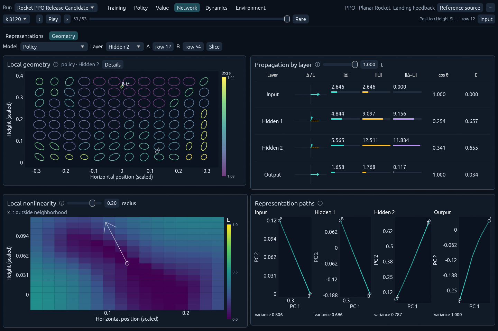
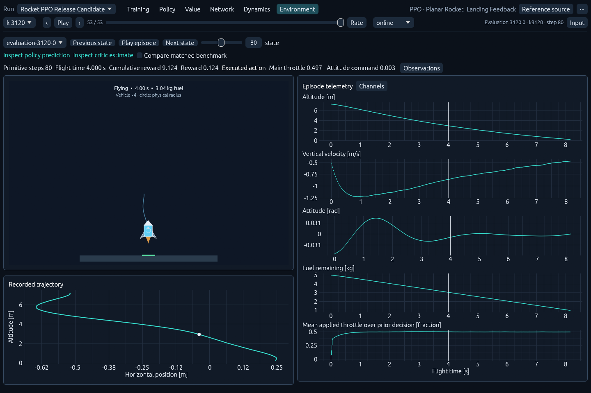
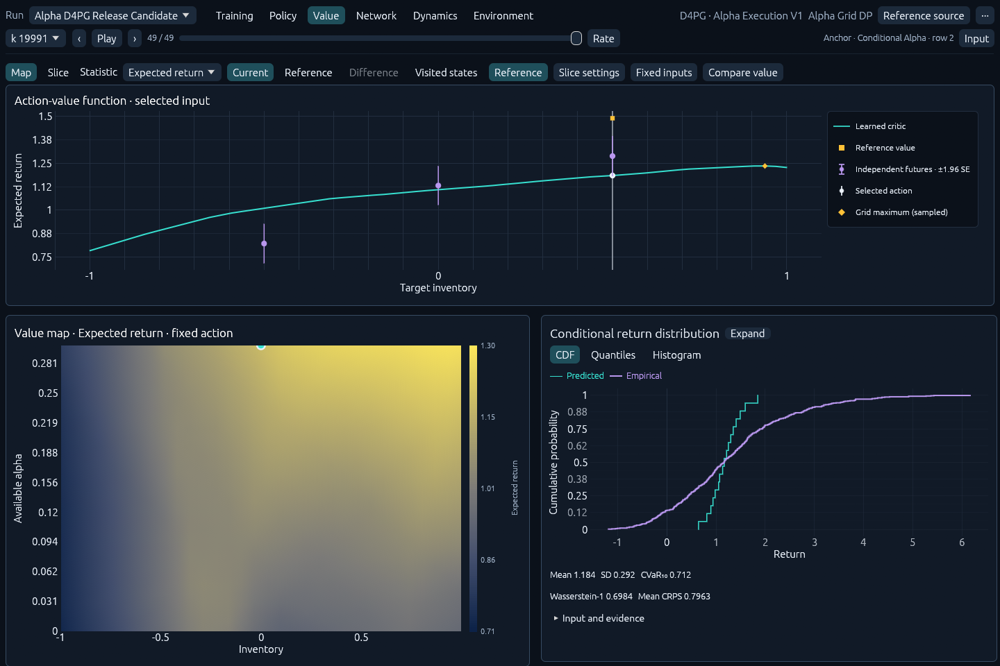

# rust-rl

Reinforcement learning, planning and interactive scientific visualization in Rust.

rust-rl pairs a modular reinforcement learning library with a native application for inspecting how policies, value functions, neural representations and agent behavior change during training.



## Download and open a demonstration

1. Download the Windows x86-64 ZIP from [GitHub Releases](https://github.com/quaere-verum/rust-rl/releases).
2. Extract the whole ZIP and launch `rl-viewer.exe`.
3. Select **Open demonstration**, then choose **Rocket Landing · PPO** or **Alpha Execution · Expected Return** from **Run**.

The archive contains the recordings and runs offline. [Installation and source builds](docs/getting-started.md)

## What rust-rl provides

- Tabular, statistical and neural reinforcement learning, with explicit and learned-model planning.
- Dense, discrete, structured and graph observations, including conditional action menus.
- Independent evaluation, optional benchmark and oracle providers, and configurable diagnostic recording.
- Checkpoint inspection, historical model inference where supported, conditional return calibration, representation analysis and episode playback.

The viewer has six workspaces for Training, Policy, Value, Network, Dynamics and Environment. It can also read recorded evidence when a model does not have a historical inference adapter. [Viewer manual and gallery](docs/viewer.md)

## Demonstrations

**Rocket Landing · PPO** follows a controller from 1 successful landing out of 200 held-out episodes at the initial checkpoint to 200 out of 200 at the final checkpoint. Inspect the policy and its geometry, then play a recorded flight beside the feedback benchmark.



**Alpha Execution** compares expected-return and CVaR-sensitive D4PG in a stylized execution simulator. Inspect the inventory policy against a numerical dynamic-programming benchmark and compare its predicted return distribution with matched simulated futures. At the documented condition, those futures have a substantially wider spread. [Demonstration walkthroughs and reproduction](docs/demonstrations.md)



## Use the Rust library

The Cargo package is `rust-rl` and the library import is `rl`. Use Rust 1.95 or newer. Add it as a path dependency from a local clone.

```toml
[dependencies]
rl = { package = "rust-rl", path = "../rust-rl/crates/rl" }
```

Run the [complete Q-learning example](crates/rl/examples/tabular_q_learning.rs). It implements a three-state environment, learns from its executed actions, and checks the learned values against the expected result.

```sh
cargo run --locked -p rust-rl --no-default-features --example tabular_q_learning
```

## Record a learning experiment

The diagnostic example trains and records a small control task. The viewer can open the resulting directory directly.

```sh
cargo run --locked -p rust-rl --features diagnostics --example diagnostic_generic -- runs/my-experiment
cargo run --locked --release -p rl-viewer -- runs/my-experiment
```

[Diagnostic recording and references](docs/diagnostics-viewer.md)

## Documentation

- [Supported algorithms](docs/algorithms.md) covers Q-learning, FQI, LSPI, policy-gradient and actor–critic methods, distributional critics and the optional stability settings.
- [Architecture](docs/architecture.md), [environment API](docs/environment-api.md) and [extending the library](docs/extending.md) explain how to add environments, learners and models.
- [Planning](docs/planning.md) and [checkpointing](docs/checkpointing.md) cover predictive models, search and reproducibility.

## Licence

rust-rl is licensed under the MIT License. [Project license](LICENSE) · [Third-party notices](THIRD-PARTY-NOTICES)
