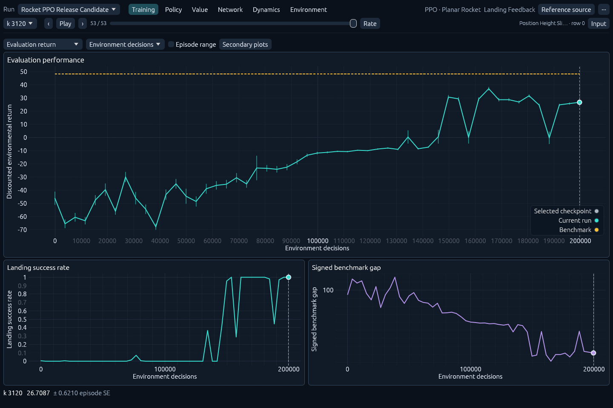
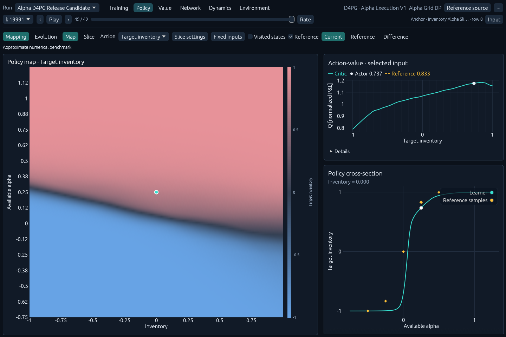
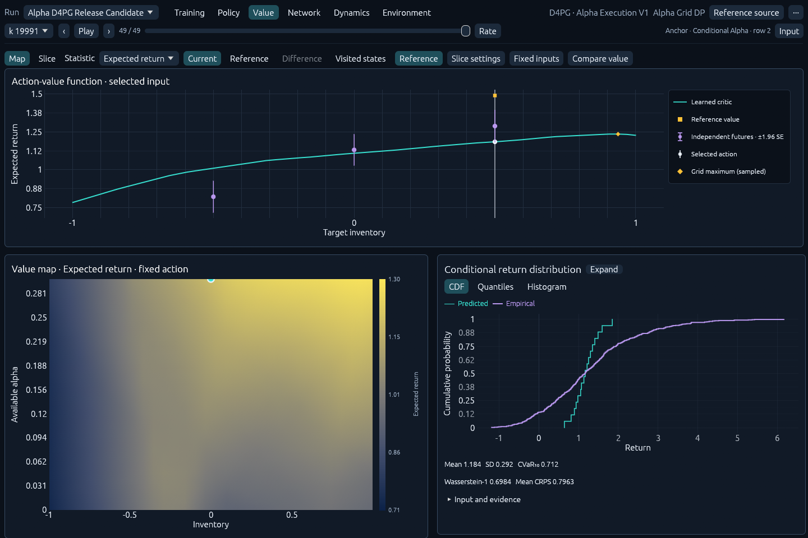
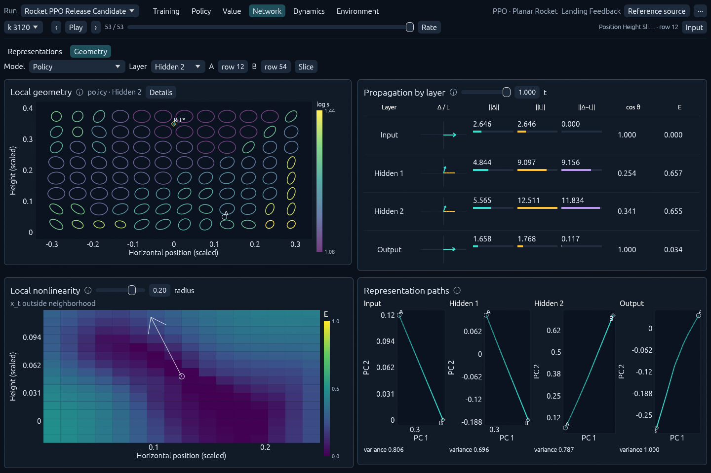
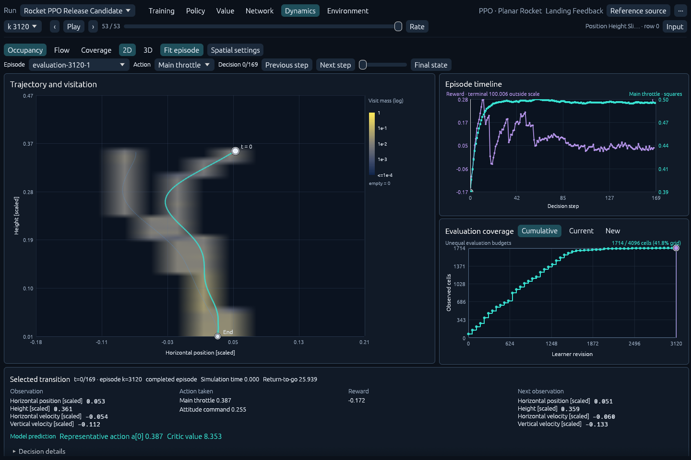
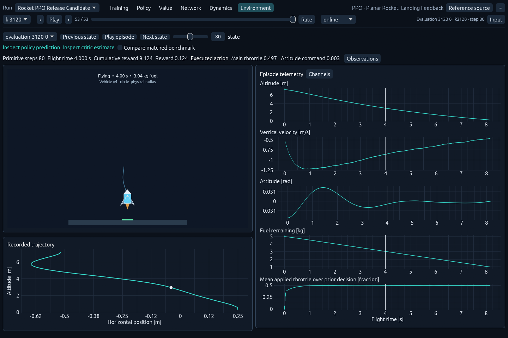

# Viewer user manual

Open `rl-viewer` and choose **Open recording**. Select the recording folder, or select a parent folder and use **Run** to switch between its recordings. The start screen offers **Open demonstration** when a bundled demonstration is available. Choose **Rocket Landing · PPO** or **Alpha Execution · Expected Return** to follow the examples below. [Getting started](getting-started.md) · [Demonstrations](demonstrations.md)

## Navigate a recording

The `k` menu selects a recorded learner revision. Use the slider to scrub checkpoints, the arrows to step, and **Play** and **Rate** to control learning playback. A **shown k** label identifies the previous complete frame while a requested checkpoint is loading. Environment’s episode transport advances within one recorded episode. It has its own play button and state slider.

| Shortcut | Action |
| --- | --- |
| `Ctrl+1` through `Ctrl+6` | Open Training, Policy, Value, Network, Dynamics, or Environment in that order |
| `Space` | Play or pause the header checkpoint transport |
| `Left` / `Right` | Step the header transport backward or forward |

Shortcuts apply when a text control does not have keyboard focus. On plots that support navigation, drag to pan, right-drag a box to zoom, and double-click to reset the view. Hover points or traces for the recorded coordinates and values. In plots with a selectable cursor or pin, clicking a point can select its checkpoint, input, or episode state.

To inspect a recording while it is being written, open it and enable **Watch recording** in the application’s **···** menu. Newly published records become available as the viewer refreshes. Use the checkpoint controls to inspect them.

## Select inputs and comparison sources

- Use **Input** to select a probe population and row or an available recorded decision. A probe is a recorded model input. Some probes also specify a complete initial action. Inspect the input and its source when comparing across checkpoints or runs.
- Use **Slice settings** to choose plotted coordinates and **Fixed inputs** to set the remaining coordinates. **Map** varies two coordinates and **Slice** varies one. In Value, choose the policy’s action or fix an action explicitly. With discrete or conditional actions, the viewer uses the recorded legal choices for that input.
- Use **Reference source** to select a recorded benchmark, the same run at another checkpoint, or a compatible run. Enable **Reference** in Policy or Value to show the overlay where supported. The source and checkpoint details tell you which model or recorded predictions supply the comparison.

## Training

*Rocket landing performance over learning, with the selected checkpoint marked on each plot.*

Choose evaluation return or a recorded metric from the main selector. The horizontal axis can use environment decisions, learner revision, primitive ticks, or elapsed wall time when the clock was recorded. Use **Secondary plots** for additional recorded metrics such as landing success. Click a plotted checkpoint to inspect it in the other workspaces.

Episode uncertainty comes from the evaluation sample at a checkpoint. **Training seeds** combines compatible independent training runs. Its uncertainty describes variation across enrolled runs. Elapsed wall time includes the work performed between recorded measurements.

## Policy

*The expected-return alpha execution policy maps inventory and available alpha to a target inventory.*

In **Mapping**, choose an action component or legal action and inspect the map, cross-section, or selected-input distribution. Deterministic policies show their action at the input. Stochastic policies expose legal-action probabilities or continuous distributions in executed action coordinates. Reference markers identify the reference action or recorded samples. A selected-input action-value curve appears when a compatible critic is available.

**Evolution** shows function-space PCA. Each point represents an entire checkpoint policy evaluated over the same fixed probe population. Its features come from legal-action probabilities, normalized deterministic actions, or the Gaussian policy’s latent means and log scales, according to the policy type. A common basis lets you inspect movement across the displayed history.

## Value

*The alpha execution critic predicts a much narrower return distribution than the 512 matched futures at the selected input.*

Choose the **Statistic** and inspect a state value or an action value on a map or slice. The selected-input action curve varies one action component while the observation and other components stay fixed. For the alpha example, select `conditional-alpha` row 2 at `k 19991` and use target inventory `0.5`. Where conditional evaluations were recorded, **Recorded empirical conditions** lets you adopt the exact observation and initial action.

Switch between **CDF**, **Quantiles**, and the empirical **Histogram** when available. **Expand distribution** gives the return profile more room. **Restore layout** returns to the map and action curve. Wasserstein-1 measures the distance between the predicted and empirical distributions. Mean CRPS scores the predictive CDF against the individual returns. Lower-tail CVaR averages the worst returns up to the chosen probability, with fractional mass at the boundary.

| Critic output | How to read it |
| --- | --- |
| Scalar or twin values | Expected-value estimates for the declared target. Twin critics expose each estimate and their disagreement. |
| Quantiles | Heads at declared probability levels. Distribution summaries use ordered atoms and their grid masses. The raw heads and crossing warning remain available. |
| Fixed-support categorical returns | The predicted probability on each fixed return atom. The CDF and tail statistics use those masses. |
| Raw moments | The first moment and raw second moment. Variance is the second moment minus the squared mean. A negative implied variance stays visible, with standard deviation unavailable. |
| HL-Gauss categorical regression | Softmax weights over scalar regression bins. The weighted average of the bin centers decodes the scalar prediction. |

## Network

*Geometry follows the change between two fixed rocket probe observations through the policy network.*

**Representations** shows recorded or reconstructable layer features through activations, heatmaps, and representation PCA. In representation PCA, each point is one input’s activation vector at a selected layer. Checkpoint comparisons on shared axes require compatible inputs and feature identities.

In **Geometry**, choose a supported network, a layer, and inputs **A** and **B**. Move `t` to inspect a point along the segment from A to B. The layer propagation plot compares the actual representation displacement with the local derivative’s tangent prediction. Local geometry and nonlinearity show how that approximation changes over a slice. The representation paths project the segment through each layer using fixed-reference PCA axes. Intermediate points and edited coordinates are neural interventions whose validity as environment states depends on the input domain.

## Dynamics

*The selected rocket transition links its position in the trajectory to reward, action, and the next observation.*

Select an episode and move through its decisions. **Occupancy** shows where recorded visits fall, **Flow** shows transitions, and **Coverage** shows which cells have been observed within the selected scope. **Fit episode** frames the displayed trajectory. The transition inspector shows the observation, executed action, reward, and next observation. If **Replay sample** is present, it shows factual training replay with its stored actions. Evaluation visitation comes from the recorded evaluation trajectories.

## Environment

*The rocket scene, flight path, and telemetry show the same physical instant in the episode.*

Choose an episode and use **Play episode**, **Previous state**, **Next state**, or the state slider. Open **Channels** to select recorded telemetry. The marker on each trace follows the selected state. The inspector shows the executed action and reward from the episode. With a rendered scene the view also shows the recorded environment frame. **Compare matched benchmark** opens a benchmark episode for the same initial scenario where the recording supplies one. Each episode keeps its own cursor.

## Interpret references and returns

A benchmark describes the behavior of a specified comparator policy. Its signed performance gap is reference return minus learner return under the matched evaluation protocol. A **verified optimal** reference supports an optimality-gap interpretation within its declared objective and input domain. The alpha execution grid dynamic program is an approximate benchmark.

**Same complete input** compares predictions for the same observation and action where compatible. **Controller values** evaluates each critic with its own controller’s first action and continuation. Current-policy, target-policy, and optimality targets describe different prediction tasks. Critic calibration requires independent returns for the declared target, including the same observation, forced first action, continuation and sampling mode, and return convention. For the alpha example, the empirical CDF uses the frozen D4PG target policy at that checkpoint. The plotted grid benchmark follows its own controller.

Environmental returns accumulate environment rewards using the recording’s declared discount and horizon. Entropy-regularized values include a policy-entropy term in the target. Potential-shaped values use a declared potential in the learning reward. Risk statistics such as lower-tail CVaR summarize a predicted return law. Environmental playback and evaluation show the recorded environmental rewards.

## Recording coverage

Light records metrics and basic evaluation when configured. Standard adds policy and critic probes, supported snapshots, and optional reference records. Detailed also schedules representations and conditional evaluation when suitable inputs and an evaluation factory are supplied. Each workspace uses the data retained for that run and checkpoint.

When historical inference is unavailable, the viewer can use recorded predictions at their original inputs. Episodes with numerical data can be inspected without a rendered scene. A dash or unavailable notice indicates missing or incompatible evidence. See the [diagnostics guide](diagnostics-viewer.md) for profile settings, recording formats, and reference requirements.
